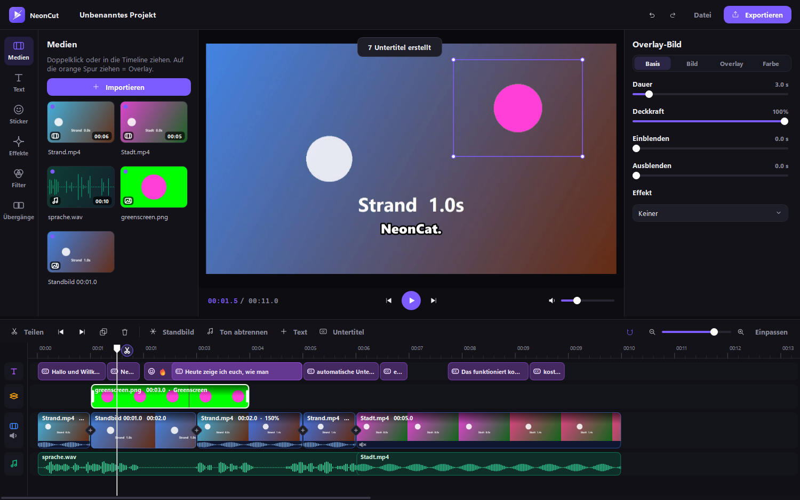
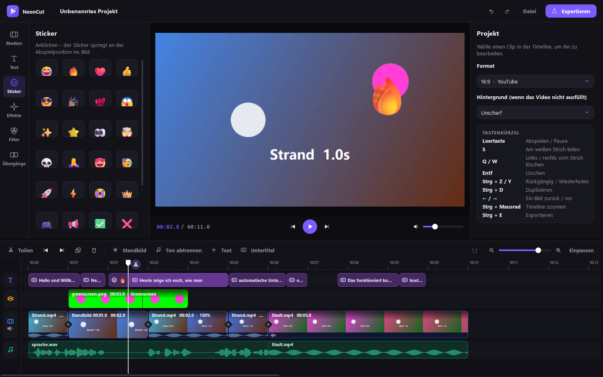
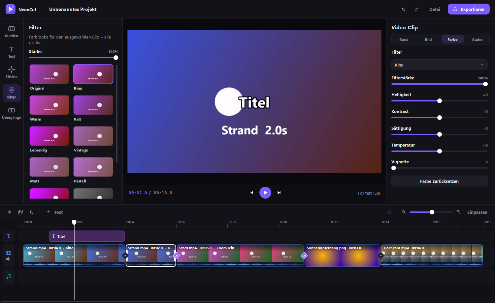

<div align="center">


# NeonCut

**Kostenloser Video-Editor für Windows – mit allen Profi-Funktionen, ohne Abo und ohne Wasserzeichen.**

[**⬇ Download (Installer)**](../../releases/latest) &nbsp;·&nbsp; Windows 10 / 11 &nbsp;·&nbsp; 100 % gratis



</div>

---

## Was kann NeonCut?

**Schneiden**
- ✂️ Timeline mit Text-, Overlay-, Video- und Musikspur – Vorschaubilder & Wellenformen
- Teilen direkt am weißen Abspiel-Strich (Scheren-Knopf oder `S`), links/rechts löschen (`Q` / `W`)
- Trimmen an den Clip-Rändern, Umsortieren per Drag & Drop, Einrasten, Rückgängig/Wiederholen
- Standbild einfügen, Ton abtrennen, Geschwindigkeit 0,1x – 4x
- Funktioniert auch mit stundenlangen Aufnahmen (z. B. OBS) – der Ton wird gestreamt

**Profi-Funktionen – hier gratis**
- 💬 **Auto-Untertitel** per KI-Spracherkennung (Whisper) – läuft lokal, ohne Upload, viele Sprachen
- 🟩 **Overlay / Bild-in-Bild** mit **Greenscreen-Entfernung** und Mischmodi
- 🎨 12 Filter mit Live-Vorschau + Helligkeit, Kontrast, Sättigung, Temperatur, Vignette
- ✨ 10 Effekte (Zoom, Wackeln, Glitch, RGB-Split, Retro-VHS …) und 10 Übergänge
- 🔤 Text-Vorlagen mit Kontur, Leuchten, Schatten & Animationen, 😎 Emoji-Sticker
- 🔇 Rauschentfernung für den Ton, Lautstärke pro Clip
- 🎬 **Export bis 4K / 60 fps, ohne Wasserzeichen** – auf Wunsch über die NVIDIA-Grafikkarte
- Formate 16:9, 9:16 (TikTok/Reels/Shorts), 1:1, 4:5, 21:9 mit unscharfem Hintergrund

<p align="center">
  
  
</p>

## Installation

1. Unter [Releases](../../releases/latest) **`NeonCut-Setup-x.y.z.exe`** herunterladen und starten.
   *(Ohne Installation: `NeonCut-Portable-x.y.z.zip` entpacken und `NeonCut.exe` starten.)*
2. Videos ins Fenster ziehen – fertig.

Für Auto-Untertitel lädt NeonCut beim ersten Mal ein Sprachmodell herunter (145 MB „Schnell“ oder 465 MB „Genau“).

## Tastenkürzel

| Taste | Aktion |
|---|---|
| `Leertaste` | Abspielen / Pause |
| `S` | Am weißen Strich teilen |
| `Q` / `W` | Links / rechts vom Strich löschen |
| `Entf` | Clip löschen |
| `Strg + Z` / `Strg + Y` | Rückgängig / Wiederholen |
| `Strg + D` | Duplizieren |
| `←` / `→` | Ein Bild zurück / vor (mit `Umschalt`: 1 Sekunde) |
| `Strg + Mausrad` | Timeline zoomen (in der Vorschau: Größe des ausgewählten Elements) |
| `Strg + E` | Exportieren |

## Häufige Fragen

<details>
<summary><b>Windows zeigt „Der Computer wurde durch Windows geschützt“</b></summary>

NeonCut ist nicht kostenpflichtig signiert. Klick auf **Weitere Informationen → Trotzdem ausführen**.
Der komplette Quellcode liegt in diesem Repository.
</details>

<details>
<summary><b>Mein Virenscanner meldet die Datei</b></summary>

Mit PyInstaller gebaute Programme werden von manchen Virenscannern fälschlich gemeldet (Fehlalarm).
Du kannst NeonCut auch aus dem Quellcode starten (siehe unten).
</details>

<details>
<summary><b>Wo werden meine Projekte gespeichert?</b></summary>

NeonCut speichert automatisch. Über *Datei → Speichern* legst du eine `.neoncut`-Projektdatei an,
die du per Doppelklick wieder öffnen kannst. Einstellungen und Sprachmodelle liegen in `%APPDATA%\NeonCut`.
</details>

## Aus dem Quellcode starten / selbst bauen

Voraussetzung: Python 3.10 – 3.13.

```bash
pip install -r requirements.txt
python neoncut.py
```

Installer + Portable-ZIP bauen (Installer braucht [Inno Setup 6](https://jrsoftware.org/isdl.php)):

```bash
pip install pyinstaller
python build_exe.py          # Ergebnis im Ordner release/
```

Neues Release: `VERSION` in `neoncut.py` erhöhen und einen Tag pushen – GitHub Actions baut alles automatisch:

```bash
git tag v1.1.0
git push origin v1.1.0
```

## Verwendete Software

[PySide6 / Qt](https://www.qt.io/qt-for-python) (LGPL) · [PyAV](https://github.com/PyAV-Org/PyAV) / FFmpeg (LGPL) ·
[faster-whisper](https://github.com/SYSTRAN/faster-whisper) / [CTranslate2](https://github.com/OpenNMT/CTranslate2) (MIT) ·
Whisper-Modelle von OpenAI (MIT) · [NumPy](https://numpy.org) · [sounddevice](https://github.com/spatialaudio/python-sounddevice) ·
[PyInstaller](https://pyinstaller.org) · [Inno Setup](https://jrsoftware.org/isinfo.php)

## Lizenz

[MIT](LICENSE)
